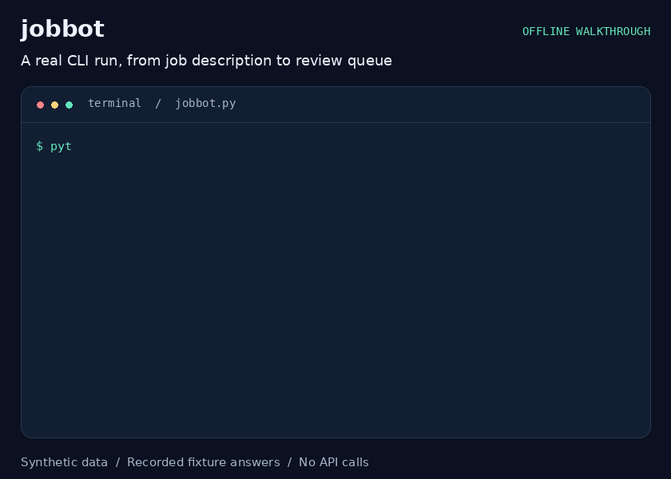
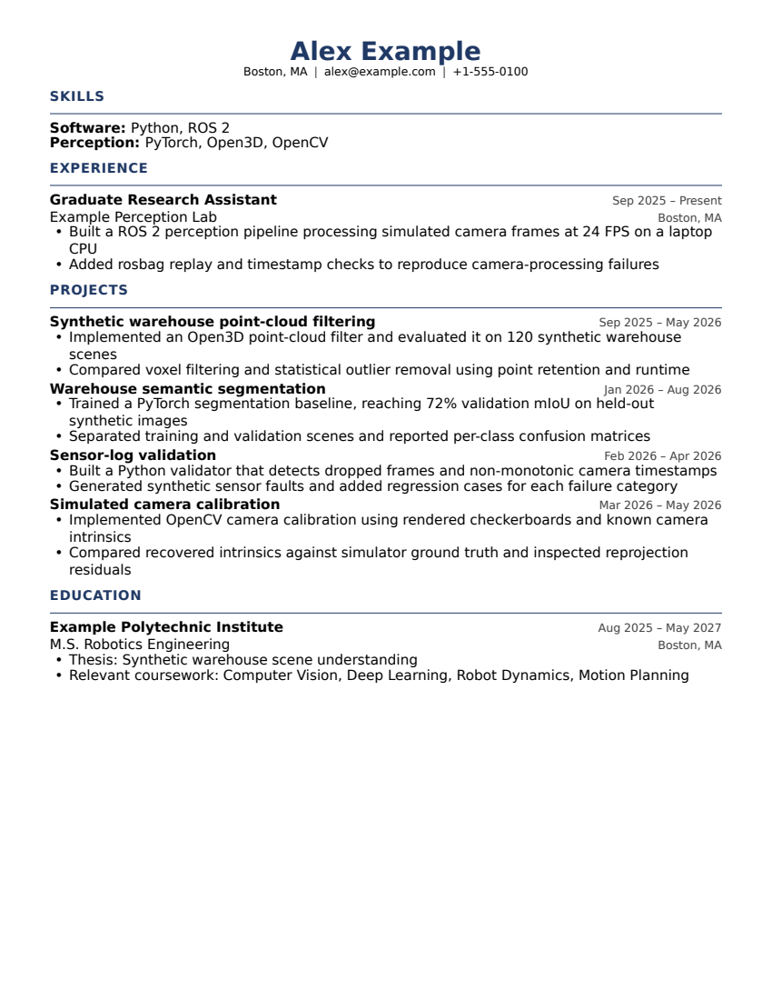

# jobbot

**Find robotics and ML roles ranked by pay. Build fact-checked applications with a seven-reader review panel. Never auto-apply.**

[](https://github.com/Shakthi-Bala/jobbot/actions/workflows/tests.yml)
[](https://github.com/Shakthi-Bala/jobbot/releases)
[](LICENSE)



*Replay of actual offline CLI output, with synthetic data and fixture review answers.*

[Quick start](#quick-start) · [Example output](#example-output) · [Workflow](#workflow) · [Review panel](#review-panel) · [Configuration](docs/configuration.md)

jobbot is a Python toolkit for finding relevant roles, assessing fit, drafting tailored résumés and cover letters, and tracking applications. It combines structured AI tasks with document checks and an explicit review step. You review the materials and submit applications yourself.

## What it does

| Capability | What you get |
| --- | --- |
| Job discovery | Greenhouse, Lever, and Ashby boards, manually supplied descriptions, and supported posting URLs. |
| Fit assessment | Strengths, gaps, quoted restrictions, and unresolved eligibility questions. |
| Application writing | A tailored résumé, a cover letter when requested or configured, and draft application answers. |
| Evidence checks | Fact references, metric consistency, required content, PDF extraction, page limits, and layout checks. |
| Review panel | Seven reader personas, an editor, saved findings, and a bounded revision loop. |
| Application tracking | A SQLite tracker, Streamlit dashboard, spreadsheet export, outcomes, and follow-up reminders. |

Approved bullet wording can be reused across applications. A gap coach identifies missing requirements and suggests work that could supply the evidence.

## Quick start

Use Python 3.10 or newer. Run these commands from the repository root:

```bash
python3 -m venv .venv
source .venv/bin/activate
python -m pip install -r requirements.txt
python jobbot.py demo
```

The offline demo runs the real import, packet, PDF-rendering, checks, and panel-report commands using the [example posting](data/evals/example-perception/posting.txt) and fictional profile. It supplies recorded JSON answers instead of calling a model. No API key, browser login, job-board request, or application submission is needed.

Open the résumé, cover letter, `checks.json`, and `panel.md` in the packet directory printed at the end. Each run gets a fresh directory under `out/demo/`; `out/demo/latest.json` records the latest paths. Scores in this demo are fixtures, not assessments of an applicant. Your existing profile and tracker are untouched.

For your own applications, run `python jobbot.py init` and edit the local files below. Initialization creates the tracker and copies examples only where those files do not already exist.

Model settings come from the tracked [example configuration](models.example.yaml). `init` copies it to ignored `models.yaml` for local changes; existing settings are preserved.

| File | Add |
| --- | --- |
| `data/profile.yaml` | Your verified experience, fact IDs, evidence, skills, work authorization, and preferences. |
| `data/answers_bank.yaml` | Your approved answers to common application questions. |
| `data/companies.yaml` | The companies and public ATS boards you want to monitor. |
| `models.yaml` | Manual or API mode and the model assigned to each role. |

See the [configuration guide](docs/configuration.md) for profile requirements and résumé settings.

### AI tasks

**Manual mode is the default.** It requires no API key. AI steps produce task files in `out/tasks/` for a coding-assistant session to answer. The CLI pauses until matching answer files are available; rerunning the command resumes the workflow.

```bash
python jobbot.py tasks          # list pending tasks
python jobbot.py tasks --check  # validate answer schemas
```

Open your coding assistant in this repository and type:

> Read AGENTS.md and answer the pending tasks in out/tasks. Validate the answers and rerun the paused command. Report any evidence gaps.

[AGENTS.md](AGENTS.md) documents the task/answer protocol and skill router; [CLAUDE.md](CLAUDE.md) points Claude Code to the same instructions. The assistant may need several rounds as later writing and review tasks are queued. Missing evidence requires your input.

**API mode** calls the Anthropic API. Set `mode: api` in `models.yaml` and provide `ANTHROPIC_API_KEY` in the process environment. Model identifiers must be available to your account. The built-in API adapter currently supports Anthropic models; other providers are not connected.

Task files and application packets contain candidate information. In either mode, the model service or coding assistant used to answer a task receives its contents.

### PDF rendering

Typst is the default renderer; its Python package is included in `requirements.txt`. For LaTeX output, set `preferences.resume_format: latex` and install a supported engine: Tectonic, latexmk, pdfLaTeX, or XeLaTeX, with the template's required packages and fonts.

Install Poppler's `pdftotext` and `pdfinfo` for PDF checks. On Debian or Ubuntu:

```bash
sudo apt install poppler-utils
```

LaTeX output uses an 11-point body with single line spacing. If a LaTeX engine is unavailable, the renderer writes a fallback note; the layout check flags that fallback rather than approving it as the intended LaTeX layout.

## Example output

This is a real rendered PDF from the offline demo. All names, projects, results, and review answers are fictional.

[](docs/assets/example-resume.pdf)

[Download the example PDF](docs/assets/example-resume.pdf) · [Panel report](docs/assets/example-panel.md) · [Check results](docs/assets/example-checks.json)

An excerpt from the generated check results:

```json
{
  "fact_ids": [],
  "numbers_match": [],
  "ats_parse": [],
  "length_limits": []
}
```

Empty lists mean those checks found no failures. They do not establish semantic truth or hiring success. The demo's panel report includes a `maybe` hiring-manager verdict and 7.2/10 fixture reader scores, illustrating how evidence gaps remain visible.

## Workflow

### 1. Add a role

Save a job description as `jd.txt`, then import it with its actual application URL:

```bash
python jobbot.py add-jd jd.txt \
  --company "Example Robotics" \
  --title "Perception Engineer" \
  --url "https://careers.example.com/jobs/perception"
```

The command prints a job ID and the next step. In manual mode, complete any pending AI task and rerun the command to continue. For configured boards or supported posting URLs:

```bash
python jobbot.py discover --no-alerts
python jobbot.py ingest POSTING_URL
python jobbot.py jobs
```

### 2. Build and review

Replace `JOB_ID` with the printed identifier:

```bash
python jobbot.py packet JOB_ID
python jobbot.py checks JOB_ID
```

The pipeline drafts documents, runs checks, requests reviews, and revises within fixed limits. Missing answers or unresolved findings stop the packet for attention. `--force` can override a fit-based skip; it cannot override a blocked posting.

Each application has its own directory under `out/`. Depending on the posting and configuration, it contains:

```text
out/<application>/
├── resume.pdf             # rendered résumé
├── cover_letter.pdf       # when requested or configured
├── answers.md             # application answers and input requests
├── wording.md             # approved wording versus new drafts
├── changes.diff           # wording changes
├── checks.json            # document check results
├── review.md              # accuracy review findings
├── panel.md               # reader scores and editor feedback
└── ats.json               # lexical coverage diagnostic
```

Open the PDFs and read the reports before submitting. Fact and number checks catch specific errors; a citation alone does not prove that a paraphrase is accurate.

### 3. Record what you submit

```bash
python jobbot.py approve JOB_ID       # retain approved bullet wording
python jobbot.py mark-applied JOB_ID  # run after submitting the application
python jobbot.py followups --draft
python jobbot.py outcome JOB_ID interview --note "Recruiter screen scheduled"
```

`mark-applied` records the submitted résumé hash and also promotes its wording. Outreach and follow-up commands prepare drafts; you send the messages yourself.

## Review panel

Seven reader personas assess the packet: ATS gate, hiring manager, team lead, competing applicant, CEO, senior engineer, and recruiter. An editor combines their findings into a revision plan. The pipeline permits up to three panel rounds and stops when unresolved issues require new evidence.

Scoring considers ownership and engineering depth, impact and validation, role focus, and communication. An optional `panel_min_score` requires every reader to meet the threshold, alongside a passing screening verdict and an interview verdict from the hiring-manager persona.

By default, approval requires all five general readers, an average of at least 8/10, a passing ATS verdict, and an interview verdict. An empty editor plan or `bulletproof` flag cannot override those gates.

**Scores are AI editorial assessments.** They are not employer ATS results or interview probabilities. The built-in panel reads extracted PDF text; visual inspection of the rendered page remains a separate step. See the [review workflow and scoring rubric](docs/resume-review-loop.md).

## Dashboard and daily use

```bash
streamlit run dashboard/app.py
python jobbot.py sheet               # refresh the application spreadsheet
python jobbot.py gaps --top 10       # assess gaps in the highest-paying roles
python jobbot.py weekly              # summarize the application funnel
python run_daily.py --top 3          # discovery, fit, and up to three packets
```

Manual-mode runs can pause for task answers. API-mode runs can incur model costs, particularly with the full review panel. Token usage is recorded in the decision log.

Tracker timestamps, calendar dates, and follow-up calculations use UTC consistently.

## Privacy and boundaries

The private profile, answers bank, credentials, tracker, uploaded résumé directory, and generated application folders are ignored by Git. Review staged files before committing; `.gitignore` does not remove files that were already tracked.

```bash
python jobbot.py privacy
python jobbot.py privacy --install-hook
```

The privacy command checks tracked files against identifiers in the active local profile and configured secrets. Its pre-push hook checks the committed contents of every outgoing commit, including earlier versions hidden by a clean working copy. PDF text and metadata are inspected; unreadable documents, oversized files, and unknown binaries require review. Synthetic image assets have reviewed hashes in [the public asset manifest](docs/assets/public-assets.json).

This is a targeted check, not a universal secret detector or an audit of copies already hosted elsewhere. Your Git author name and email remain normal public attribution. The configured repository URL is permitted for project links and badges. Keep credentials in the process environment or the ignored `.env` file.

The application workflow prepares materials for human review. It does not submit applications or send recruiter outreach. External model calls, job-board requests, and explicitly configured notifications still communicate with their respective services.

## Development

```bash
python -m pytest
python jobbot.py eval run baseline
python jobbot.py eval compare baseline candidate
```

Tests use isolated fixtures and do not require paid model calls. [GitHub Actions](.github/workflows/tests.yml) runs them on Python 3.10 and 3.12 with Typst and PDF tools installed. Saved evaluations help compare prompt changes; inspect their inputs before running model-backed evaluations. The [changelog](CHANGELOG.md) records fixes and remaining limitations.

| Directory | Purpose |
| --- | --- |
| [`agents/`](agents/) | Discovery, fit, writing, review, rendering, and tracking. |
| [`checks/`](checks/) | Deterministic checks against packet content and artifacts. |
| [`skills/`](skills/) | Agent instructions, reader personas, and playbooks. |
| [`templates/`](templates/) | LaTeX and Typst document templates. |
| [`principles/`](principles/) | Evidence, eligibility, and human-review rules. |
| [`tests/`](tests/) | Regression tests and isolated fixtures. |

The workflow structure draws inspiration from [pstack](https://github.com/cursor/plugins/tree/main/pstack): focused skills, fixed playbooks, and rules enforced in code.

Licensed under the [MIT License](LICENSE).
